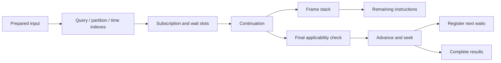

# Runtime architecture

EEL runs many partial recognitions over the same event stream. A candidate can
produce a complete result and still retain a continuation that can grow. Indexes
reduce the number of waits examined for each input; they do not replace pattern
execution or final predicate evaluation.

This guide describes the implementation in this checkout. Start with the
[language guide](../README.md) for syntax and public options.

## From source to a running candidate

[EEL::Slang](../lib/EEL/Slang.rakumod) extends the RakuAST grammar with `event`
and `pattern` declarations. The compiler constructs an
[EEL::Definition](../lib/EEL/Definition.rakumod) tree containing sequences,
calls, repetitions, alternatives, actions and other operations. Embedded Raku
code is represented by closures; compiling a definition does not execute its
actions. Materializing a pattern binds those closures to its event context.

Some predicates retain a structured representation in
[EEL::Condition](../lib/EEL/Condition.rakumod). Comparisons, definition tests,
and literal `starts-with`/`ends-with` calls can supply index restrictions.
Unsupported expressions remain ordinary Raku predicates.

A definition describes what *could* execute. Each running recognition has its
own [continuation](../lib/EEL/Continuation.rakumod), describing what remains:

| State | Purpose |
|---|---|
| `result` | Derived event context and domain attributes |
| `frames` | Stack of pattern/subpattern invocations |
| `frame.todo` | Instructions remaining in that invocation |
| `frame.captures` | Named captures belonging to the frame |
| `query` | Predicate for the next event wait |
| `windows`, `partition` | Temporal and partition constraints |
| `selections`, `choices` | Repeat policies and ordered-alternative decisions |
| `consumed`, `done` | Consumption count and completion state |

Frames also retain definitions, local-state bookkeeping and the scope settings
that must be restored on return. A continuation is data, not a suspended thread.

## Where the next steps live

For example, this is executable pattern syntax:

```raku
use EEL;
event ThreeSteps {
    pattern TOP {
        <s=.event(:type<S>)>
        <a=.event(:type<A>)>
        <b=.event(:type<B>)>
    }
}
```

After consuming `S`, the candidate is conceptually waiting with:

```text
captures = { s: the received S event }
query    = type equals A
frames   = [ TOP frame ]
todo     = [ wait for A, wait for B ]
```

This is a schematic view, not a serialized representation. Actual `todo` items
are definition nodes and internal markers, not source strings.

In [EEL::Runner](../lib/EEL/Runner.rakumod), `!seek` expands instructions until
it reaches an event wait, a special monitoring boundary, or completion. Actions
and scope operations run during this expansion. At an `event` call, it evaluates
the query arguments and leaves that call at the front of `todo`.

When an input satisfies the wait, `!consume` removes the call, records captures,
updates event contexts and timestamps, increments consumption, then seeks again.
After `A`, the example waits for `B`. When the last frame returns, it is complete.
Subpattern calls push frames; returns pop them and restore saved scope settings.

Repetitions use a `Repeat` marker with a count. The runner can branch into
another occurrence or the suffix when the bounds permit. It does not unroll an
unbounded repetition in advance. Alternatives and conjunctions also create
paths; shuffle tracks separate operand continuations and event assignments.

## Storage and event processing

A [MemoryStorage](../lib/EEL/MemoryStorage.rakumod) subscription contains an
internal ID, query, continuation, wait slots and group memberships. Slots carry
query, partition and temporal constraints. Index hits lead back to subscriptions
and their execution state:



The runner keeps separate storage for active continuations and initial waits
that can start new recognitions. [RetainedStore](../lib/EEL/RetainedStore.rakumod)
holds complete conclusions awaiting release decisions; it is not the collection
of continuations that can consume future events.

For each input processed in event-time order, the runner:

1. Expires waits whose deadlines have been reached.
2. Finds potentially applicable active waits and initial waits.
3. Confirms applicability using the prepared input view and predicates.
4. Advances matching candidates; ignores unrelated events or invalidates strict
   paths according to their scope and partition.
5. Starts applicable new recognitions and prepares replacement initial waits.
6. Selects complete conclusions for emission, then trims unneeded history.

Strict paths must also see relevant unexpected events, so query-index misses
alone cannot decide which paths to invalidate. New starts are considered before
selection, allowing them to compete with older starts in the same round.

## Forks, actions and identity

A repetition can both conclude now and keep growing. Forking creates independent
execution state for these paths. [EEL::State](../lib/EEL/State.rakumod) preserves
aliases and cycles while copying managed state. The runner shares safe compiled
definitions or rematerializes factories and restores local bindings as needed,
without replaying actions. Raw input objects retain their identity. Closures and
opaque application objects can also retain identity: copying isolates managed
state, not arbitrary external object graphs.

Previously emitted results remain independent snapshots. A candidate's growing
continuation does not mutate its earlier emitted results. Its `event-id` is
preserved across growth; a different recognition start has a different ID.
Forks preserve their originating identity, so this ID is not a unique identifier
for every speculative branch or emission. Each snapshot carries the timestamp
of its last consumed event.

Storage subscription IDs and completion `result-order` values are internal
bookkeeping identifiers. They are distinct from the derived event's `event-id`.

Actions execute on speculative paths, including candidates that will not be
emitted. Domain attributes such as `$!count` belong to copied candidate state;
external effects such as writing files or sending requests are not rolled back.
Query predicates and partition extractors should be pure: search may skip or
reuse evaluations. There is no promise of one predicate invocation per input.

## Selection and sliding windows

Repeat selection operates on complete conclusions available in the processing
round, grouped by derived type, repeat origin and partition:

| Quantifier policy | Emission |
|---|---|
| No suffix | Match consuming the most events |
| Suffix `?` | Match consuming the fewest events |
| Suffix `!` | Every complete conclusion |

Bounds still apply: `?` allows at most one occurrence, `+` requires at least one,
and `**` uses its explicit limits. Zero can win the minimum policy when the
pattern permits it. Ranking uses total events consumed, not a domain counter.
Ties for maximum/minimum use stable result order. Losing a selection does not
remove the live continuation that could grow later. Ordered alternatives may
hold otherwise complete results while a higher-priority path is still viable.

For this executable pattern:

```raku
use EEL;
event WindowedCount {
    has UInt $.count = 0;
    pattern TOP { :3s [ <event> { $!count++ } ]* }
}
```

Five inputs at timestamps 0, 1, 2, 3 and 4 produce:

| Input timestamp | Nonempty active candidate counts | Emitted count | Winning start |
|---|---|---|---|
| 0 | 1 | 1 | 0 |
| 1 | 2, 1 | 2 | 0 |
| 2 | 3, 2, 1 | 3 | 0 |
| 3 | 3, 2, 1 | 3 | 1 |
| 4 | 3, 2, 1 | 3 | 2 |

The first three emissions share an ID. The next two winners have different IDs.
Zero-occurrence conclusions are omitted from the table; they do not win the
maximum policy here. A `*?` version selects zero instead.

Windows use event timestamps and exclusive upper bounds: a candidate started at
0 under `:3s` expires before consuming the input at 3. Scope restoration ends
local windows independently of enclosing ones.

## Indexes: finding waits rather than querying an event archive

The indexes primarily store **subscriptions waiting for future input**, not an
archive of all past events. Given an input, they retrieve waits it might satisfy.

| Restriction | Implementation |
|---|---|
| Literal equality | Hash buckets |
| Type | Tag/class buckets, including inheritance handling |
| Presence and definition | Field-state buckets |
| Numeric ranges | AVL interval trees |
| Literal string prefix/suffix | Forward/reverse Unicode grapheme tries |
| Partition | Key-based routing |
| Temporal applicability | Interval index |
| Deadline expiry | Deadline queue |

[Query](../lib/EEL/Query.rakumod) produces necessary restrictions in disjunctive
normal form: alternative plans are unioned; restrictions inside a plan are
conjoined. Field lookup prefers a literal key before interpreting dots as a
nested path. Missing fields never satisfy field conditions. Present undefined
values differ from missing fields; `False`, `0` and `''` are defined.

[SearchIndex](../lib/EEL/SearchIndex.rakumod) chooses one anchor per nonempty
plan using population estimates. After finding anchor hits, it can check cached
cross-field equality, type, presence, definition and numeric restrictions before
returning subscription IDs. This is incremental restriction intersection, not
materialization of every posting-list intersection. Numeric check-cache keys
include both bounds, endpoint openness and coercion policy. Keys are prepared
when registrations are installed, rather than rebuilt for every hit.

Two adaptive choices reduce unnecessary work:

- MemoryStorage compares estimated query-index work with partition routing,
  using hysteresis and periodic probes before changing strategies.
- SearchIndex skips low-yield secondary checks and periodically probes again.

The optimization must allow false positives rather than discard valid matches.
Full predicate evaluation remains authoritative. Exact numeric filtering uses
`Int`, `Rat` and `FatRat`; other representations retain original comparisons.
Custom `.defined`, `.starts-with` and `.ends-with` methods are not invoked by
those index filters. Literal string edges use tries; dynamic edges and arbitrary
blocks retain callable fallback. Removing subscriptions prunes unused trie nodes.

An index is not guaranteed to help when nearly every wait accepts an event.
The adaptive path can prefer routing/scan instead. These structures also consume
memory, which must be considered alongside candidate reduction and elapsed time.

## Input time, assertions and termination

[Input](../lib/EEL/Input.rakumod) prepares snapshots of fields and normalized
metadata; captures preserve original raw data. A timestamp queue orders inputs
by event time and arrival order for ties. The watermark is the maximum received
time minus configured lateness. Inputs older than the committed watermark are
rejected with a diagnostic. Idle flow and `.pending` do not advance time.

Assertions use isolated monitoring continuations. When necessary, the runner
retains event history for replay, with consumed/blocked-event bookkeeping for
assertions and shuffle. This is separate from the subscription indexes.
[Absence](../lib/EEL/Absence.rakumod) records why and when a negative assertion
was confirmed. Goals also track whether a required closer was satisfied.

EOF drains buffered input and settles constructions that depend on the end of
input, including assertions and ordered alternatives. It does not flush losing
repeat snapshots. Cancellation clears state without confirming pending absence
or publishing held conclusions. Exceptions propagate through the runner/Supply
lifecycle and failed runners cannot continue processing.

All storage is in memory. There is no durable checkpoint or restart recovery.
Each Supply subscription owns its runner; execution is event-driven, with no
thread allocated per candidate. Without suitable windows or terminating paths,
continuations and required history can grow without a fixed bound.

## Verification and diagnostics

Run from the repository root:

```sh
mi6 test
raku -Ilib tools/benchmark-indexes.raku --size=1000 --rounds=50
```

Benchmarks compare indexed processing with linear evaluation for specific
workloads. Their timings are measurements, not universal speed guarantees.
Candidate reduction is checked separately from timing thresholds.

Internal hooks and statistics help inspect behavior:

| Metric/hook | Meaning |
|---|---|
| Storage `candidates-count` | Subscriptions proposed for examination |
| SearchIndex `visited` | Anchor postings and index traversal work, not a uniform CPU-cost unit |
| `intersected` | Secondary restriction checks in the last lookup |
| `pruned` | Anchor hits rejected by secondary checks |
| `prefix-nodes`, `suffix-nodes` | Currently retained trie nodes |
| Runner `EEL-work` | Cumulative execution counters and retained-history size |
| Runner `EEL-linear-search` | Internal differential-testing route |

These are implementation diagnostics, not a stable persistence format or public
query-planner API. Useful executable references include:

- [Selection and windows](../t/34-per-event-selection.t)
- [Candidate identity and CLI](../t/35-candidate-identity.t)
- [Presence and definition](../t/36-presence-index.t)
- [Cross-field intersection](../t/37-index-intersection.t)
- [Prefix tries](../t/38-prefix-index.t) and [suffix tries](../t/39-suffix-index.t)
- [Numeric intersection and coercion](../t/40-range-intersection.t)
- [Assertions and replay](../t/31-assertion-integration.t)
